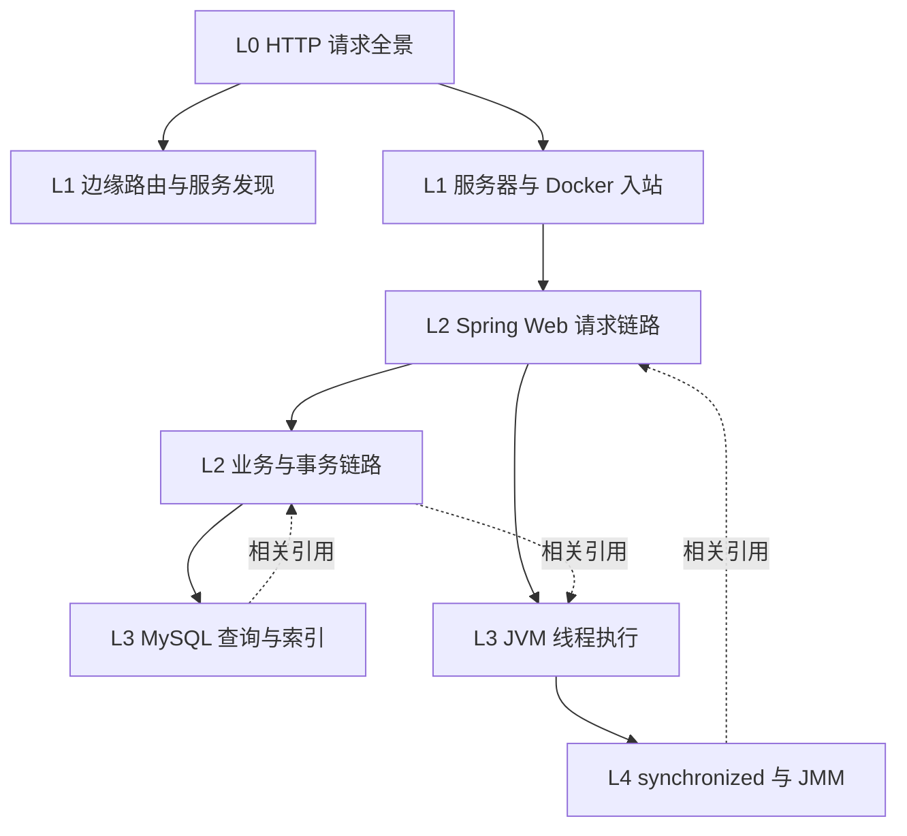

# M0：首批 8 个知识页内容大纲

> 状态：待技术审核
> 内容基线：Java 21、Spring MVC Servlet 栈、Spring 声明式事务、Tomcat 10.1、Docker Engine Linux bridge、MySQL 8.4 InnoDB。
> 表达原则：主链路只放“正常请求必经或在本场景假设下必经”的步骤；可选行为进入分支说明，不能伪装成必经步骤。

## 1. 首批内容关系

内容规模基线：

| 页面 | 主节点数 | 主流程边 | 分支/返回边 | 下钻 | 相关引用 |
|---|---:|---:|---:|---:|---:|
| HTTP 请求全景 | 9 | 8 | 2 | 5 | 2 |
| 边缘路由与服务发现 | 9 | 8 | 3 | 3 | 2 |
| 服务器与 Docker 入站 | 8 | 7 | 3 | 3 | 2 |
| Spring Web 请求链路 | 10 | 9 | 3 | 4 | 3 |
| 业务与事务链路 | 9 | 8 | 4 | 4 | 3 |
| MySQL 查询与索引 | 10 | 9 | 4 | 3 | 3 |
| JVM 线程执行 | 9 | 8 | 4 | 3 | 3 |
| synchronized 与 JMM | 8 | 7 | 4 | 2 | 3 |
| **合计** | **72** | **64** | **27** | **27** | **21** |

## 2. L0：一次 HTTP 请求全景

### 页面定义

- `slug`：`http-request-panorama`
- 回答的问题：一个外部 HTTPS 请求如何找到正确实例、执行业务并把响应返回浏览器？
- 输入：浏览器已经获得目标 URL。
- 入口节点：`browser`
- 出口节点：`browser-response`
- 抽象边界：只解释系统级路由，不展开单个组件内部实现。

### 主链路

| 序号 | 节点 key | 标签 | 本层职责 |
|---:|---|---|---|
| 1 | `browser` | 浏览器 | 组装 URL、Header、Cookie 和请求体 |
| 2 | `dns-resolution` | DNS 解析 | 把域名解析为可访问的边缘地址 |
| 3 | `edge-entry` | CDN / WAF | TLS 终止、静态命中或安全检查；本场景假设请求继续回源 |
| 4 | `load-balancer` | 负载均衡器 | 把连接或请求送到一个健康 Gateway |
| 5 | `api-gateway` | API Gateway | 路由、鉴权、限流并选择后端服务 |
| 6 | `service-instance` | Java 服务实例 | 在容器内接收并处理请求 |
| 7 | `business-processing` | 业务与数据访问 | 执行业务规则并访问缓存/数据库 |
| 8 | `response-path` | 响应回程 | 按连接反向穿过 Gateway 和边缘组件 |
| 9 | `browser-response` | 浏览器收到响应 | 解析状态码、Header 和响应体 |

主流程：

`浏览器 -> DNS -> CDN/WAF -> LB -> Gateway -> Java 实例 -> 业务与数据访问 -> 响应回程 -> 浏览器`

### 分支与异常

- CDN 静态命中：在 `edge-entry` 直接返回，不进入 Gateway；
- DNS、TLS、Gateway、服务实例和数据库均可能超时，必须在说明面板区分失败发生在哪一层；
- HTTP keep-alive、HTTP/2 多路复用会复用连接，不表示每个请求都重新建立 TCP/TLS；
- 多实例不等于每层都做一次负载均衡，本页假设 LB 选择 Gateway，Gateway/客户端负载均衡选择业务实例。

### 下钻与引用

- `dns-resolution` → 后续 `dns-resolution`
- `load-balancer`、`api-gateway` → `edge-routing-and-discovery`
- `service-instance` → `server-container-path`
- `business-processing` → `service-business-transaction`
- `service-instance` 相关引用 → `jvm-thread-execution`
- `business-processing` 相关引用 → `mysql-query-and-index`

### 验收问题

用户看完后应能回答：

1. DNS 选择的是地址，不是直接执行 Java Controller；
2. LB 与 Gateway 的职责可能重叠，但当前场景为何保留两层；
3. 响应不是另找一条随机路径，而是沿已有连接和代理链路返回。

## 3. L1：边缘路由与服务发现

### 页面定义

- `slug`：`edge-routing-and-discovery`
- 回答的问题：Gateway 如何把一个请求路由到某个健康的服务实例？
- 输入：外部 LB 已把请求交给某个 Gateway。
- 入口节点：`gateway-ingress`
- 出口节点：`selected-instance`
- 抽象边界：解释控制面提供实例列表、数据面完成请求转发，不绑定 Eureka、Nacos 或 Consul。

### 主链路

| 序号 | key | 标签 | 本层职责 |
|---:|---|---|---|
| 1 | `gateway-ingress` | Gateway 入站 | 接收已经建立的 HTTP 请求 |
| 2 | `request-normalization` | 请求规范化 | 解析 Host、Path、Method 和关键 Header |
| 3 | `security-check` | 身份与权限检查 | 验证身份上下文；失败直接返回 |
| 4 | `rate-limit` | 限流 | 检查租户、用户或路由配额 |
| 5 | `route-match` | 路由匹配 | 把请求映射到逻辑服务 ID |
| 6 | `instance-supplier` | 实例列表供应器 | 从发现缓存/注册中心获得候选实例 |
| 7 | `health-filter` | 健康与元数据过滤 | 去除不健康或不符合 zone/hint 的实例 |
| 8 | `load-balance` | 负载均衡策略 | Round Robin、Random、权重或一致性策略 |
| 9 | `selected-instance` | 目标实例 | 重写目标 URI 并转发 |

### 分支与异常

- 鉴权失败返回 `401/403`；限流失败返回 `429`，两者不会继续选实例；
- 实例列表为空返回 `503`，不能把“随机选一个已下线实例”当降级；
- 实例缓存降低注册中心压力，但带来短暂陈旧，需要健康状态和重试边界；
- 是否重试、重试几次必须与请求幂等性共同设计。

### 下钻与引用

- `route-match` → 后续 `gateway-routing`
- `instance-supplier` → 后续 `service-registry-consistency`
- `load-balance` → 后续 `load-balancing-algorithms`
- `selected-instance` 下钻 → `server-container-path`
- 相关引用 → `http-request-panorama`、`spring-web-request-chain`

### 依据

- Spring Cloud LoadBalancer 使用 `ServiceInstanceListSupplier` 提供候选实例，并提供 Round Robin、Random、权重、zone 与健康检查等策略：
  <https://docs.spring.io/spring-cloud-commons/reference/spring-cloud-commons/loadbalancer.html>

## 4. L1：服务器与 Docker 入站链路

### 页面定义

- `slug`：`server-container-path`
- 回答的问题：请求到达服务器网卡后，怎样进入 Docker 容器里的 Java 进程？
- 输入：一个发往宿主机已发布端口的网络包。
- 入口节点：`host-nic`
- 出口节点：`jvm-socket`
- 场景假设：Linux 宿主机、Docker user-defined bridge、端口发布模式；host/overlay 网络是版本注记，不混入主链路。

### 主链路

| 序号 | key | 标签 | 本层职责 |
|---:|---|---|---|
| 1 | `host-nic` | 宿主机网卡 | 接收以太网帧/网络包 |
| 2 | `linux-network-stack` | Linux 网络栈 | 完成 IP、TCP 处理和 socket 匹配前的网络处理 |
| 3 | `netfilter-nat` | Netfilter / NAT | 根据 Docker 端口发布规则改写/转发目标 |
| 4 | `docker-bridge` | Docker bridge | 宿主机上的软件网桥 |
| 5 | `host-veth` | Host veth | bridge 一侧的虚拟网卡 |
| 6 | `container-netns` | 容器 network namespace | 通过容器侧 veth 进入隔离网络栈 |
| 7 | `container-port` | 容器监听端口 | 找到 Java 进程监听的 socket |
| 8 | `jvm-socket` | JVM / Tomcat socket | 连接进入 Servlet 容器处理范围 |

### 分支与异常

- 防火墙或安全组可在进入 Docker 前丢弃数据；
- 未发布端口默认不能从其他网络直接访问；
- 同一 user-defined bridge 上的容器可以按名称解析并通信；
- `host` 网络不会经过相同的 bridge/veth 路径，必须单独成变体；
- 网络包的精确 Netfilter hook 与 Docker 实现版本有关，本页不把具体链名写成永久不变事实。

### 下钻与引用

- `linux-network-stack` → 后续 `linux-tcp-receive`
- `docker-bridge` → 后续 `docker-networking`
- `jvm-socket` → `spring-web-request-chain`
- `jvm-socket` 相关引用 → `jvm-thread-execution`
- 反向引用 ← `http-request-panorama`

### 依据

- Docker bridge 为同一 Docker daemon 上的容器提供软件桥接和隔离，端口发布负责从宿主机地址转发到容器端口：
  <https://docs.docker.com/engine/network/drivers/bridge/>

## 5. L2：Spring Web 请求链路

### 页面定义

- `slug`：`spring-web-request-chain`
- 回答的问题：请求进入 Tomcat 后，如何定位并调用某个 Spring MVC Controller？
- 输入：Tomcat Connector 的 socket 已有可读请求。
- 入口节点：`tomcat-connector`
- 出口节点：`http-response-write`
- 场景假设：Spring MVC Servlet 栈，不混入 WebFlux。

### 主链路

| 序号 | key | 标签 | 本层职责 |
|---:|---|---|---|
| 1 | `tomcat-connector` | Tomcat Connector | 处理客户端连接和 HTTP 协议 |
| 2 | `executor-thread` | Executor 工作线程 | 从线程池获得一个执行请求的线程 |
| 3 | `servlet-filter-chain` | Servlet FilterChain | 安全、日志、编码等 Servlet 过滤器 |
| 4 | `dispatcher-servlet` | DispatcherServlet | Spring MVC Front Controller |
| 5 | `handler-mapping` | HandlerMapping | 根据请求找到 Handler 与拦截器链 |
| 6 | `handler-adapter` | HandlerAdapter | 选择合适适配器调用 Handler |
| 7 | `argument-resolution` | 参数解析与校验 | 解析 Header、Path、Body 并执行校验 |
| 8 | `controller` | Controller 方法 | 接收应用层请求并调用 Service |
| 9 | `return-value` | 返回值与消息转换 | 执行返回值处理和 `HttpMessageConverter` |
| 10 | `http-response-write` | 写回响应 | 经过拦截器/Filter 退出路径写入连接 |

### 分支与异常

- Filter 可提前写响应并终止链路；
- 找不到 Handler、参数校验失败、消息转换失败均不会进入正常业务方法；
- Controller 异常先进入 `HandlerExceptionResolver`，解析成功后仍可生成统一响应；
- async Servlet 会释放当前容器线程并在异步派发时重新进入部分链路，不能与同步流程混写；
- Tomcat Connector 默认可使用内部线程池，也可关联共享 Executor。

### 下钻与引用

- `tomcat-connector` → 后续 `tomcat-nio`
- `servlet-filter-chain` → 后续 `spring-security-filter-chain`
- `dispatcher-servlet` → 后续 `spring-mvc-dispatch`
- `controller` → `service-business-transaction`
- `executor-thread` 相关引用 → `jvm-thread-execution`
- `argument-resolution` 相关引用 → 后续 `java-reflection`
- 反向引用 ← `server-container-path`

### 依据

- Spring MVC 使用 `DispatcherServlet` 作为 Front Controller，并通过 Handler 与 delegate 组件处理请求：
  <https://docs.spring.io/spring-framework/reference/web/webmvc/mvc-servlet/sequence.html>
- Tomcat Connector 处理客户端通信，Executor 可为 Connector 提供线程池：
  <https://tomcat.apache.org/tomcat-10.1-doc/architecture/overview.html>
  <https://tomcat.apache.org/tomcat-10.1-doc/config/executor.html>

## 6. L2：业务与事务链路

### 页面定义

- `slug`：`service-business-transaction`
- 回答的问题：Controller 调用 Service 后，Spring 声明式事务怎样包围数据库操作？
- 输入：已经完成协议解析和参数校验的应用请求。
- 入口节点：`controller-call`
- 出口节点：`service-result`
- 场景假设：命令型同步请求、Spring AOP 代理、`PlatformTransactionManager`、关系数据库本地事务。

### 主链路

| 序号 | key | 标签 | 本层职责 |
|---:|---|---|---|
| 1 | `controller-call` | Controller 调用 Service | 从 Web 层进入应用服务 |
| 2 | `service-proxy` | Spring AOP 代理 | 拦截外部方法调用 |
| 3 | `transaction-interceptor` | TransactionInterceptor | 读取事务元数据并决定传播行为 |
| 4 | `transaction-manager` | PlatformTransactionManager | 开启/加入事务并绑定资源 |
| 5 | `business-rule` | 业务规则 | 校验状态、计算和编排数据访问 |
| 6 | `repository` | Repository / Mapper | 发起 SQL 或 ORM 操作 |
| 7 | `database-operation` | MySQL 操作 | 执行查询/写入并返回结果 |
| 8 | `commit-or-rollback` | 提交或回滚 | 根据正常返回或异常规则结束事务 |
| 9 | `service-result` | 返回 Controller | 代理返回结果或重新抛出异常 |

### 分支与异常

- 同类内部自调用可能绕过默认代理，导致 `@Transactional` 不生效；
- imperative 事务通常绑定当前线程，不会自动传播到方法内新建线程；
- 默认回滚规则与异常类型有关，不能简单表述为“所有 Exception 都回滚”；
- Redis cache-aside 操作通常不受本地 MySQL 事务原子保护，需要单独解释一致性；
- 数据库提交成功但后续发消息失败属于跨资源一致性问题，应下钻到 Outbox，不塞入本地事务主链。

### 下钻与引用

- `service-proxy` → 后续 `spring-aop-proxy`
- `transaction-interceptor` → 后续 `spring-transaction-propagation`
- `database-operation` → `mysql-query-and-index`
- `commit-or-rollback` → 后续 `innodb-transaction-mvcc`
- 相关引用 → `jvm-thread-execution`、后续 `redis-cache-aside`、后续 `transactional-outbox`

### 依据

- Spring 声明式事务由 AOP 代理、`TransactionInterceptor` 与合适的 `TransactionManager` 围绕方法调用实现；imperative 事务通常绑定当前线程：
  <https://docs.spring.io/spring-framework/reference/data-access/transaction/declarative/tx-decl-explained.html>

## 7. L3：MySQL 查询与索引

### 页面定义

- `slug`：`mysql-query-and-index`
- 回答的问题：一条按普通二级索引查询的 SQL 如何找到 InnoDB 行记录？
- 输入：应用已从连接池获得连接并发送参数化 SQL。
- 入口节点：`jdbc-send`
- 出口节点：`result-set`
- 场景假设：MySQL 8.4、InnoDB、查询命中二级 B+Tree；覆盖索引和全表扫描作为分支。

### 主链路

| 序号 | key | 标签 | 本层职责 |
|---:|---|---|---|
| 1 | `jdbc-send` | JDBC 发送 SQL | 通过 MySQL 协议提交语句和参数 |
| 2 | `mysql-session` | MySQL Session | 认证后的连接上下文接收命令 |
| 3 | `parse-preprocess` | 解析与预处理 | 构建语法树并解析对象/权限 |
| 4 | `optimizer` | 优化器 | 估算代价并选择访问路径 |
| 5 | `executor-handler` | Executor / Handler | 按计划调用存储引擎接口 |
| 6 | `secondary-btree` | 二级索引 B+Tree | 根据索引键定位叶子记录 |
| 7 | `primary-key-value` | 取得主键值 | 二级索引记录包含主键列 |
| 8 | `clustered-index` | 聚簇索引查找 | 非覆盖查询按主键再次定位完整行 |
| 9 | `buffer-pool-page` | Buffer Pool 数据页 | 命中内存页或触发页读取 |
| 10 | `result-set` | 结果集返回 | 过滤/投影后经协议返回应用 |

### 分支与异常

- 覆盖索引包含查询所需列时可跳过聚簇索引回表；
- 优化器可能选择聚簇索引、其他索引或全表扫描，B+Tree 不是所有 SQL 的固定必经节点；
- Buffer Pool 未命中才需要从存储读取页面；
- 二级索引叶子保存主键列，因此过长主键会放大所有二级索引；
- 锁等待、MVCC 可见性和 undo 读取进入后续独立页面。

### 下钻与引用

- `optimizer` → 后续 `mysql-optimizer`
- `secondary-btree` → 后续 `btree-page-structure`
- `buffer-pool-page` → 后续 `innodb-buffer-pool`
- 相关引用 → `service-business-transaction`、后续 `innodb-lock-mvcc`、后续 `jdbc-connection-pool`

### 依据

- InnoDB 聚簇索引通常为主键并保存行数据；二级索引记录包含主键列，非覆盖查询再使用主键查聚簇索引：
  <https://dev.mysql.com/doc/refman/8.4/en/innodb-index-types.html>

## 8. L3：JVM 线程执行

### 页面定义

- `slug`：`jvm-thread-execution`
- 回答的问题：Tomcat 工作线程如何在 JVM 内执行一段同步请求代码？
- 输入：线程池把请求任务交给一个工作线程。
- 入口节点：`executor-queue`
- 出口节点：`task-complete`
- 抽象边界：解释 Java 线程、栈、堆、JIT 与阻塞点，不暗示每个请求必然触发 GC。

### 主链路

| 序号 | key | 标签 | 本层职责 |
|---:|---|---|---|
| 1 | `executor-queue` | 工作队列 | 请求任务等待可用 Worker |
| 2 | `worker-thread` | Java 工作线程 | 取得任务并开始运行 |
| 3 | `java-stack` | Java 栈与栈帧 | 保存方法局部变量、操作数栈和返回信息 |
| 4 | `compiled-code` | 解释器 / JIT 代码 | 执行方法字节码或已编译机器码 |
| 5 | `heap-allocation` | 堆对象分配 | 创建 DTO、集合和业务对象 |
| 6 | `synchronization-point` | 同步点 | 仅在代码需要锁/volatile 等同步时发生 |
| 7 | `blocking-io` | 数据库/网络等待 | 同步 I/O 可能让线程等待或 park |
| 8 | `stack-unwind` | 返回与栈帧退出 | 结果或异常沿调用栈返回 |
| 9 | `task-complete` | 线程归还池 | Worker 继续取得下一个任务 |

### 分支与异常

- 队列满或线程达到上限时触发拒绝、排队延迟或背压；
- 对象分配可能走 TLAB/慢路径，但不是所有对象都立刻进入老年代；
- GC 与 safepoint 是运行时并发事件，不应画成每个请求固定步骤；
- 阻塞 I/O 占用平台线程；虚拟线程的挂载/卸载语义需要单独版本页；
- 未捕获异常由容器边界捕获并转成错误响应，线程池 Worker 通常继续服务后续任务。

### 下钻与引用

- `worker-thread` → 后续 `java-thread-pool`
- `heap-allocation` → 后续 `jvm-heap-gc`
- `synchronization-point` → `synchronized-and-jmm`
- 相关引用 → `spring-web-request-chain`、`service-business-transaction`、后续 `virtual-threads`

## 9. L4：synchronized 与 Java Memory Model

### 页面定义

- `slug`：`synchronized-and-jmm`
- 回答的问题：线程进入和退出一个 `synchronized` 临界区时，互斥与可见性如何建立？
- 输入：线程执行到同步块或同步方法。
- 入口节点：`sync-entry`
- 出口节点：`sync-exit`
- 内容基线：Java 语言与 JVM 规范；HotSpot 的对象头、快路径和 park 只作为实现注记。

### 主链路

| 序号 | key | 标签 | 本层职责 |
|---:|---|---|---|
| 1 | `sync-entry` | 到达同步点 | 求值锁对象或确定同步方法监视器 |
| 2 | `monitor-acquire` | 尝试获取 monitor | 同一时刻只允许持有者进入临界区 |
| 3 | `contention` | 无竞争或发生竞争 | 竞争者等待；实现可使用自旋、阻塞或 park |
| 4 | `critical-section` | 执行临界区 | 持有 monitor 的线程执行受保护代码 |
| 5 | `shared-state-write` | 读写共享状态 | 程序仍需让所有相关访问遵循同一同步协议 |
| 6 | `monitor-release` | 释放 monitor | 正常或异常退出都必须释放 |
| 7 | `happens-before` | 建立 happens-before | 对 monitor 的 unlock happens-before 后续对同一 monitor 的 lock |
| 8 | `sync-exit` | 后继线程继续 | 当前线程继续执行，等待者获得竞争机会 |

### 分支与异常

- 同步块通常编译为 `monitorenter`/`monitorexit`，同步方法由 `ACC_SYNCHRONIZED` 标志表达；
- `synchronized` 是可重入的，同一线程可再次获取同一 monitor；
- 获取锁不会阻止其他线程执行未同步访问，因此共享变量仍可能发生数据竞争；
- `wait` 会释放 monitor 并进入等待集合，`sleep` 不释放 monitor；
- 偏向锁、对象头位布局、轻量/重量术语属于 HotSpot 版本实现，不作为 Java 语义保证；
- 临界区抛异常仍应经编译器生成的异常路径执行释放。

### 下钻与引用

- `monitor-acquire` → 后续 `hotspot-monitor-implementation`
- `happens-before` → 后续 `java-memory-model`
- 相关引用 → 后续 `aqs-and-reentrantlock`、`jvm-thread-execution`、后续 `volatile-memory-semantics`

### 依据

- JVM `monitorenter`/`monitorexit` 指令：
  <https://docs.oracle.com/javase/specs/jvms/se21/html/jvms-6.html#jvms-6.5.monitorenter>
- Java Memory Model happens-before 规则：
  <https://docs.oracle.com/javase/specs/jls/se21/html/jls-17.html#jls-17.4.5>

## 10. 首轮技术审核清单

每页审核者必须逐项确认：

- [ ] 主链路没有把可选动作画成必经动作；
- [ ] 输入和输出位于同一抽象层级；
- [ ] 版本依赖已在场景假设中标明；
- [ ] 异常分支不会在失败后错误回到正常后继节点；
- [ ] 下钻目标比当前节点至少低一个解释层级；
- [ ] 相关引用不是当前执行流的一部分；
- [ ] 术语与官方文档一致；
- [ ] 用户可在 60 秒内说出本页入口、三个关键步骤和出口。
