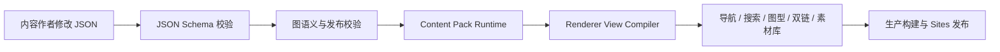

# M1 数据驱动内容引擎

## 目标

让知识内容与 React 渲染代码解耦。维护者修改 Content Pack 后，导航、搜索、下钻、
双向引用、素材库、数量表达和三种图型自动更新。

当前规范文件：

```text
packages/content-schema/schema/content-pack.schema.json
```

首个真实内容包：

```text
prototype/content/packs/java-http-request.json
```

## 数据流



## 模块

| 模块 | 责任 |
|---|---|
| `content/packs/*.json` | 唯一内容事实源 |
| `content-engine.ts` | 加载内容包、创建索引、解析入口、汇总统计 |
| `graph-data.ts` | 将 Schema 模型编译为渲染器只读视图 |
| `asset-library.tsx` | 渲染素材图形，文案与分类来自 Content Pack |
| `validate-content.mjs` | Schema、图语义和发布要求门禁 |
| `diagram-renderers.tsx` | 只消费编译视图，不感知内容存储格式 |

## 内容包发布要求

一个仓库内可发布 Content Pack 必须包含：

- `packVersion`、`status`、`updatedAt` 和至少一个作者；
- 至少一个有效场景入口；
- 每页的 `question`、`assumption` 和 `layout.diagramType`；
- 每页恰好一条 `MAIN_FLOW` 页面说明；
- 存在的入口、出口、边、下钻、引用、解释锚点和素材；
- 从入口可达所有声明出口；
- 无下钻自环或循环；
- 数量高亮不超过示意图标数量。

## 新增知识页流程

1. 在目标 Content Pack 的 `pages` 中添加页面；
2. 声明节点、边、入口、出口、主链路说明和场景假设；
3. 从上层节点增加 `drillTo`，需要横向关联时增加 `references`；
4. 复用已有 `assetKey`，数量差异使用 `multiplicity`；
5. 执行 `npm run check`；
6. 通过 PR 完成技术与表达审核后发布。

在当前内容包内新增页面不需要修改 React 文件。

## MVP 取舍

- 当前仅支持 JSON authoring；
- 当前使用构建期加载，内容与站点版本一起发布；
- 当前只有一个激活的 Content Pack；
- `sequence` 定义主链路排序，复杂并行图的独立路径选择留给后续版本；
- 数据库修订、审批状态机和原子 Publication Snapshot 按总体规划在后端阶段实现。

## 验收结果

- 1 个真实 Content Pack；
- 8 个知识页、72 个节点、64 条主链路边；
- 20 个双语素材；
- 页面入口和所有统计由数据自动生成；
- 正式内容包、Schema fixture、语义反例、服务端渲染和生产构建统一进入检查。

