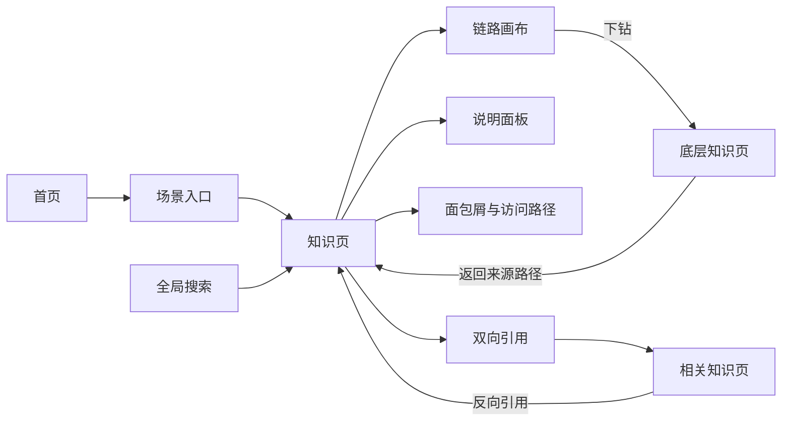
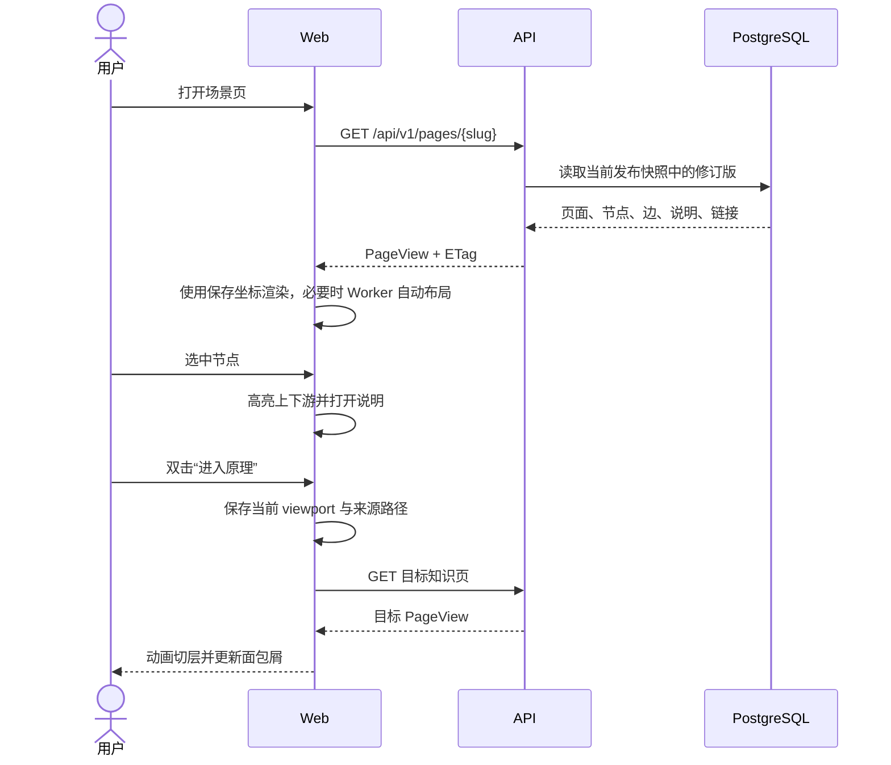
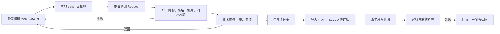
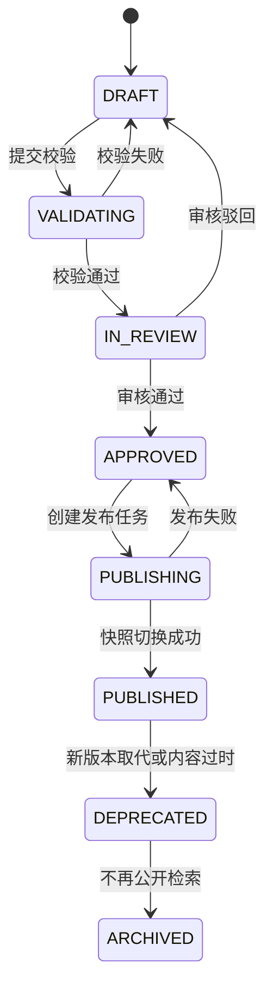
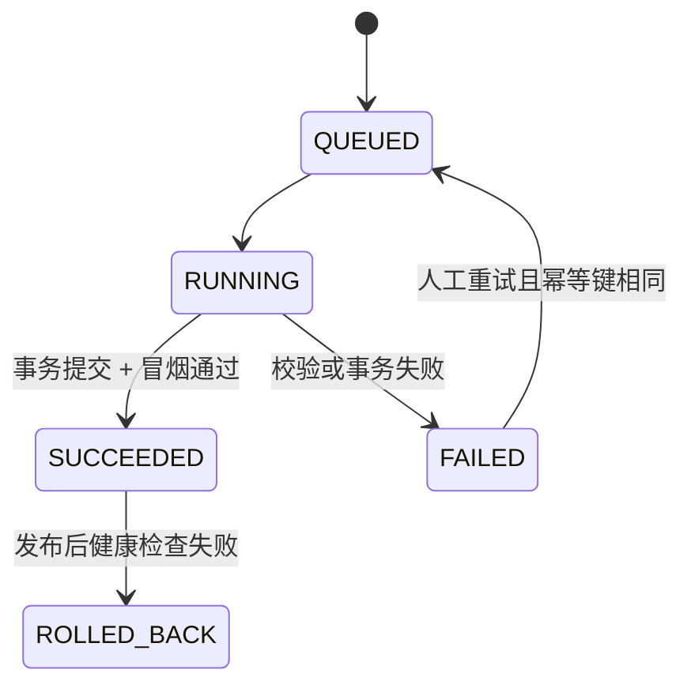
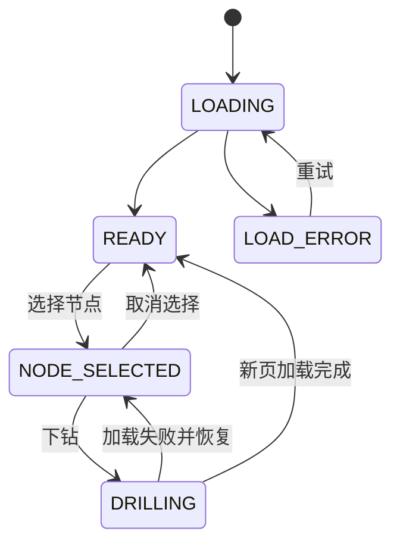
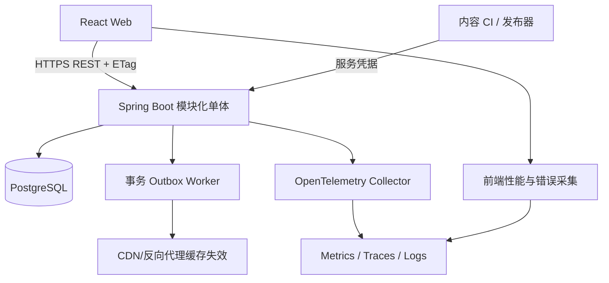

# PrincipleGraph 五阶段总体规划

> 状态：设计基线 v0.1
> 日期：2026-07-25
> 核心原则：先证明“分层原理图谱能让用户看懂并持续下钻”，再扩充知识总量与编辑能力。

## 0. 执行摘要

PrincipleGraph 不是一张无限大的脑图，而是由许多“小而完整的知识页”组成的有向图：

- 每个知识页只解释一个抽象层级，包含 8–20 个主要节点；
- 页内使用流程边表达真实执行方向；
- 节点使用下钻链接进入更底层知识页；
- 页面和节点使用相关引用形成双向知识连接；
- 页面右侧用结构化说明解释前置条件、主链路、分支、异常和返回值；
- 用户路径是树状下钻体验，底层存储允许页面被多个上层复用，因此整体是有向图而不是严格树。

MVP 的唯一主场景是“一次 HTTP 请求穿过多实例 Java 微服务并返回”。首版交付 8 个知识页、至少 60 个节点、70 条流程边、12 条双向引用和一条连续 4 层以上的下钻路径。

### 0.1 MVP 交付边界

| 能力 | MVP | 后续 |
|---|---|---|
| 公开浏览 | 完整支持 | 个性化学习路径 |
| 缩放、拖拽、聚焦、全屏 | 支持 | 演示模式、讲解动画 |
| 节点下钻、返回、面包屑 | 支持 | 多路径对比 |
| 双向引用 | 支持 | 引用关系图、影响分析 |
| 标题/别名/标签搜索 | 支持 | 中文分词、语义搜索 |
| 文字解释与节点联动 | 支持 | 音视频、代码沙箱 |
| 内容维护 | Git 中的 YAML/JSON + CI 校验 + 导入 | Web 图谱编辑器、多人协同 |
| 登录和权限 | 浏览匿名；发布由 CI 凭据完成 | OIDC、RBAC、审核工作台 |
| 自由手绘 | 不支持 | 仅作为辅助注释能力评估 |
| 全局无限画布 | 不支持 | 提供全局知识地图的聚合视图 |

### 0.2 架构结论

- 前端：React + TypeScript + React Flow，ELK 在 Web Worker 中完成分层布局；
- 后端：Java 21 + Spring Boot 3.5.x 模块化单体；
- 数据：PostgreSQL 18，结构化关系表为主，`JSONB` 只承载节点视觉扩展属性；
- 内容：仓库内版本化内容包，CI 校验通过后调用导入/发布接口；
- 可观测：OpenTelemetry + Micrometer，开发环境使用 Prometheus/Grafana/Tempo 或等价组件；
- 部署：MVP 为 Web、API、PostgreSQL 三个运行单元，不拆微服务。

---

# 第一阶段：项目定义

## 1.1 问题定义

Java 面试知识通常按 JVM、Spring、MySQL、Redis、微服务等目录分散组织。真实请求执行时，这些知识却同时参与同一条链路。传统文章和脑图存在三个断点：

1. 目录关系不等于运行关系，用户知道概念却说不清请求先后经过什么；
2. 一张大图信息密度过高，一篇文章又缺少空间上下文；
3. 同一知识点被多个场景引用时，复制内容会造成冲突与失效。

PrincipleGraph 用“场景页 + 分层下钻 + 双向引用”解决这三个断点。

## 1.2 产品目标与非目标

### 产品目标

1. 用户可以从一个生产级场景沿主链路逐步进入底层原理；
2. 每一层都能独立回答“输入是什么、依次发生什么、输出到哪里”；
3. 同一知识页可以被多个业务场景复用；
4. 任意引用都能返回来源，避免单向跳走后丢失上下文；
5. 内容发布前可自动发现断链、孤点、环路和不完整链路；
6. 数据模型可承载未来具体项目的业务拓扑。

### MVP 非目标

- 不承诺覆盖全部 Java 面试题；
- 不建设在线代码执行平台；
- 不建设实时协同白板；
- 不根据用户简历自动生成面试题；
- 不在首版引入 Neo4j、Kafka、Elasticsearch、Kubernetes；
- 不把像素级自由绘图数据当作核心知识数据。

## 1.3 用户与角色

| 角色 | 核心任务 | MVP 权限 |
|---|---|---|
| 访客 `VISITOR` | 浏览、搜索、下钻、跟随引用 | 匿名只读 |
| 内容作者 `AUTHOR` | 编写页面、节点、流程与说明 | Git 提交内容包 |
| 审核者 `REVIEWER` | 校验技术正确性、可理解性和引用关系 | Git Review + CI 报告 |
| 发布者 `PUBLISHER` | 将已审核版本发布 | CI 使用服务凭据调用发布接口 |
| 管理员 `ADMIN` | 用户、空间、回滚和审计 | 后续 Web 控制台；MVP 用运维命令 |

## 1.4 核心领域语言

| 名称 | 定义 | 约束 |
|---|---|---|
| 知识空间 `Space` | 一组可独立发布的知识内容，例如“Java 后端知识图谱” | MVP 仅一个 |
| 场景 `Scenario` | 用户进入图谱的业务/学习入口，例如“HTTP 请求全景”或“电商下单” | 指向一个入口知识页 |
| 知识页 `Page` | 一个可直接访问的抽象层级，是浏览和发布的基本单位 | 必须有稳定 `slug` |
| 修订版 `Revision` | 某知识页的一次不可变内容快照 | 发布后不可修改 |
| 节点 `Node` | 页内组件、动作、边界、数据、注释或入口/出口 | `stableKey` 在修订版内唯一 |
| 流程边 `Flow Edge` | 当前层级内的执行或数据流向 | 必须带方向 |
| 下钻链接 `Drill Link` | 从节点进入更底层知识页 | MVP 禁止形成下钻环 |
| 相关引用 `Reference` | “使用、依赖、对比、前置、另见”等跨页关系 | 默认创建反向引用 |
| 数量语义 `Multiplicity` | 节点在拓扑或运行时中的固定、示意或动态数量 | 必须说明单位与当前请求落点 |
| 说明块 `Explanation Block` | 对主链路、分支、异常、节点或边的文字解释 | 可绑定节点/边 |
| 内容包 `Content Pack` | 可由 CI 校验和导入的一组页面文件 | 具有 schema 版本 |
| 发布快照 `Publication` | 某时刻一个空间内所有已发布修订版的原子映射 | 可回滚 |

## 1.5 信息与视觉语义

同一种视觉必须始终表达同一种语义：

| 语义 | 默认视觉 | 交互 |
|---|---|---|
| 入口/出口 | 胶囊节点 | 聚焦说明 |
| 系统/组件 | 带图标矩形节点 | 选中；存在下钻时双击进入 |
| 处理动作 | 圆角步骤节点 | 查看步骤详情 |
| 数据存储 | 圆柱节点 | 可下钻到存储原理 |
| 边界/容器 | 淡色分组框 | 折叠/展开组内节点 |
| 同步调用 | 实线箭头 | 显示协议、序号、耗时语义 |
| 异步消息 | 虚线箭头 | 显示 Topic/Queue |
| 异常/补偿 | 红色点划线 | 打开异常说明 |
| 下钻 | 节点右下角“进入原理”标记 | 双击或按钮进入 |
| 相关引用 | 侧栏双链，不混入主链路 | 打开新页并保留返回路径 |
| 多实例/多线程 | 重复小图标 + `1/N/T/K` 数量标签 | 高亮当前请求落点；侧栏解释固定、示意或动态 |

“下钻”和“相关引用”不能复用同一种边，否则用户无法判断这是执行流还是知识关系。重复图标只表达拓扑数量，不复制流程节点；示意图标数量不得冒充实时副本数。

## 1.6 MVP 内容地图

| 层级 | `slug` | 完整主链路 | 可下钻节点 |
|---|---|---|---|
| L0 | `http-request-panorama` | 浏览器 → DNS/CDN → LB → Gateway → Java 实例 → 数据层 → 响应 | DNS、LB、服务器、Java 服务、MySQL |
| L1 | `edge-routing-and-discovery` | LB → Gateway → 鉴权/限流 → 服务发现 → 实例选择 → 转发 | Gateway、服务发现、负载均衡 |
| L1 | `server-container-path` | 网卡 → Linux 网络栈 → iptables/NAT → Docker bridge → 容器端口 → JVM | Linux 网络、Docker、JVM |
| L2 | `spring-web-request-chain` | Connector → 线程池 → Filter → DispatcherServlet → Handler → Controller → 返回 | Tomcat、Filter、Spring MVC |
| L2 | `service-business-transaction` | 参数校验 → Service → 事务代理 → Repository → 缓存/数据库 → 提交 | AOP、事务、Redis、MySQL |
| L3 | `mysql-query-and-index` | 连接池 → 解析/优化 → B+Tree 定位 → 回表/覆盖索引 → 返回 | Buffer Pool、锁、MVCC |
| L3 | `jvm-thread-execution` | Socket 就绪 → 工作线程 → 栈帧 → 对象分配 → GC 安全点 → 响应 | 线程池、内存模型、GC |
| L4 | `synchronized-and-jmm` | monitorenter → 锁竞争/升级语义 → 临界区 → happens-before → monitorexit | AQS 对比、对象头 |

首版只要求上述页面技术上正确且相互连接。HashMap、Redis 持久化、Kafka、分布式事务等作为下一批内容，不应阻塞 MVP。

## 1.7 成功指标

### 产品指标

| 指标 | 定义 | MVP 目标 |
|---|---|---|
| 三层下钻完成率 | 会话中完成至少 3 次有效下钻的用户 / 开始下钻用户 | ≥ 40% |
| 主链路理解率 | 可用性测试中正确复述入口、关键步骤与出口的用户 | ≥ 80% |
| 搜索成功率 | 搜索后 30 秒内打开结果的搜索次数 / 总搜索次数 | ≥ 70% |
| 搜索零结果率 | 无结果次数 / 总搜索次数 | < 15% |
| 引用回访率 | 访问相关引用后通过来源路径返回的会话占比 | 仅观测，建立基线 |
| 内容完整率 | 通过全部发布校验的页面 / 待发布页面 | 100% |

### 技术 SLO

| 指标 | 目标 |
|---|---|
| 首页 LCP P75 | 桌面宽带 < 2.5s |
| 知识页 API P95 | < 300ms |
| 页面切层到可交互 P95 | < 800ms |
| 公开 API 月可用性 | ≥ 99.9% |
| 客户端图谱渲染错误率 | < 0.5% 页面浏览 |
| 发布后断链数 | 0 |

## 1.8 阶段出口标准

项目定义阶段完成必须同时满足：

- 8 个 MVP 页面的标题、入口、出口和主链路经过 Java 技术审核；
- 选取 5 名目标用户完成低保真走查；
- 至少 4 人能区分流程边、下钻与相关引用；
- 对“单页节点上限、默认文字位置、双击下钻”形成书面结论；
- 明确 MVP 不包含在线白板编辑器。

---

# 第二阶段：业务设计

## 2.1 用户端信息架构



知识页固定布局：

1. 顶栏：空间、全局搜索、页面标题、版本与分享；
2. 左侧：当前访问路径和本页目录；
3. 中间：占主要面积的链路画布；默认按视口宽度折行铺满，不要求用户横向寻找主链路；
4. 右侧：当前节点/边说明、主链路解释、前置知识、异常分支；
5. 底栏浮层：缩放、适配视口、重置布局、图例、全屏。

移动端 MVP 采用只读简化模式：画布全宽，说明以底部抽屉显示；不承诺小屏编辑。

## 2.2 浏览流程

### 2.2.1 首次进入与下钻



下钻失败时不清空当前页面；显示可重试提示，并保留用户的选中节点和视口。

### 2.2.2 双向引用

1. 用户选中节点，右侧展示“深入原理”和“相关知识”两个独立区域；
2. 点击相关知识进入目标页，URL 携带 `fromPage` 与 `fromNode`；
3. 目标页展示“来自：某页 / 某节点”；
4. 目标页的“引用此页”列表由服务端反查生成，不依赖作者手写第二条关系；
5. 分享 URL 不依赖浏览器历史，也可直接打开。

### 2.2.3 搜索

搜索排序权重：

`标题精确匹配 > 别名匹配 > 标签匹配 > 标题相似度 > 摘要包含`

结果必须展示：

- 页面标题和一句摘要；
- 所属领域与层级；
- 命中的别名/标签；
- 最短入口场景，例如“从 HTTP 请求全景下钻 3 层可达”。

首版不对整篇 Markdown 做复杂中文全文检索，避免搜索噪声。

## 2.3 内容生产与发布流程

MVP 使用 Git 内容包作为编辑入口：



每个页面内容文件应包含：

```yaml
schemaVersion: 1
page:
  slug: spring-web-request-chain
  title: Spring Web 请求链路
  summary: HTTP 请求从 Connector 到 Controller 再返回的完整过程
  domain: spring
  entryNodeKey: socket-ready
  exitNodeKeys: [http-response]
nodes:
  - key: dispatcher-servlet
    type: COMPONENT
    label: DispatcherServlet
    drillTo: spring-mvc-dispatch
    position: { x: 680, y: 240 }
edges:
  - key: filter-to-dispatcher
    from: filter-chain
    to: dispatcher-servlet
    type: SYNC
    order: 4
explanations:
  - key: main-flow
    kind: MAIN_FLOW
    title: 主链路
    body: "请求通过 FilterChain 后进入 DispatcherServlet。"
references:
  - fromNode: dispatcher-servlet
    targetPage: spring-aop-proxy
    relation: RELATED
```

## 2.4 状态机

### 2.4.1 修订版生命周期



约束：

- `PUBLISHED` 内容不可原地修改，只能从它复制出新的 `DRAFT`；
- 同一知识页只允许一个 `PUBLISHED` 修订版出现在当前发布快照；
- `APPROVED` 之后内容哈希必须固定，发布任务发现哈希变化立即失败；
- 回滚切换的是 `Publication`，不篡改历史修订版。

### 2.4.2 发布任务状态机



### 2.4.3 浏览器页面状态机



## 2.5 发布校验规则

### 阻断发布

- 页面 `slug` 重复或发生不兼容重命名；
- 节点 `stableKey` 重复；
- 边的起点或终点不存在；
- 入口节点不存在、出口列表为空；
- 从入口无法到达任一出口；
- 主流程存在未标注的有向环；
- 下钻目标不存在或不在同一发布快照；
- 下钻关系存在自环或循环；
- Markdown 含不允许的 HTML/脚本；
- 页面无主链路说明；
- 数量高亮值大于示意图标数，或数量缺少单位和解释；
- 发布包 schema 版本不受支持。

### 警告但可发布

- 单页主要节点超过 20 个；
- 节点没有说明；
- 没有任何反向引用；
- 人工坐标存在重叠；
- 页面只有一条入口路径，复用度低；
- 引用目标标记为 `DEPRECATED`。

## 2.6 内容治理

每页至少经过两类审核：

1. 技术审核：执行顺序、边界条件、版本差异和术语正确；
2. 教学审核：单层抽象一致、文字与图对应、没有跨层泄漏过多细节。

内容完成定义：

- 标明适用版本，例如 Java 21、Spring Boot 3.x/4.x 差异；
- 主链路包含入口、出口和编号顺序；
- 至少描述一个正常分支和一个异常/边界分支；
- 每个缩写首次出现时给出全称；
- 可下钻节点不得只链接到占位页；
- 外部事实给出权威来源及核对日期。

## 2.7 业务阶段验收

使用 5 个任务进行可用性测试：

1. 从首页找到“一次 HTTP 请求”场景；
2. 指出请求在哪一步选择具体服务实例；
3. 从服务器下钻到 Docker 容器，再进入 JVM；
4. 从 Spring 事务页跳到 MySQL 索引页，并返回来源；
5. 搜索 `synchronized` 并说出其与 JVM 线程页的关系。
6. 解释 `N 个 Java 实例`、`T 个 Worker` 和高亮的 `1` 分别表示什么。

通过标准：5 名目标用户中至少 4 名无需指导完成前 4 项，至少 3 名完成全部任务；任何人都不把“相关引用”误认为“执行步骤”。

---

# 第三阶段：技术设计

## 3.1 总体架构



运行单元：

1. `web`：静态资源和客户端应用；
2. `api`：公开查询、内容导入、发布和搜索；
3. `postgres`：领域数据、发布快照、搜索索引与 Outbox；
4. 可观测组件只在开发/测试一键启动，生产可接托管平台。

## 3.2 模块边界

### 前端模块

| 模块 | 职责 | 不负责 |
|---|---|---|
| `app-shell` | 路由、布局、错误边界、主题 | 图谱业务规则 |
| `graph-canvas` | 节点/边渲染、选择、高亮、缩放 | 获取发布状态 |
| `graph-layout` | ELK Worker、坐标缓存、布局降级 | 内容校验 |
| `navigation` | 下钻、来源路径、面包屑、浏览历史 | 浏览器原生历史替代 |
| `explanation` | Markdown 渲染、节点/边锚点联动 | 任意 HTML |
| `search` | 搜索框、结果、键盘导航 | 服务端排序 |
| `telemetry` | Web Vitals、交互事件、错误上报 | 采集正文或隐私数据 |

前端状态分层：

- URL：当前 `slug`、选中锚点、来源页面；
- TanStack Query：服务端页面和搜索结果；
- Zustand：当前视口、选中节点、访问路径、图例开关；
- React 本地状态：面板展开、临时 hover；
- IndexedDB/localStorage：最近访问与每页视口，不保存发布内容真相。

### 后端模块

| 模块 | 核心职责 | 对外依赖 |
|---|---|---|
| `catalog` | 知识页稳定身份、标签、别名 | PostgreSQL |
| `content` | 修订版、节点、边、说明、引用 | PostgreSQL |
| `validation` | schema、图完整性、下钻环检测 | `catalog`、`content` |
| `publication` | 发布快照、回滚、Outbox | `validation` |
| `query` | 面向浏览的聚合 DTO、ETag | 当前发布快照 |
| `search` | 标题/别名/标签检索、可达入口 | PostgreSQL `pg_trgm` |
| `identity` | CI 服务凭据、后续 OIDC/RBAC | Spring Security |
| `audit` | 导入、审核、发布、回滚审计 | PostgreSQL |
| `observability` | 指标、追踪、健康检查 | OpenTelemetry |

模块间只通过应用服务接口和领域事件调用，不跨模块直接访问 Repository。代码层使用 ArchUnit 约束依赖方向。

## 3.3 技术选型与取舍

### 3.3.1 结构化画布

**选择：React Flow。**

理由：

- 节点是 React 组件，可精确实现组件、数据库、容器、入口/出口等视觉语义；
- 原生支持端口、多边、分组/子流、视口、选择和连接交互；
- 知识节点保留稳定 ID，便于搜索、埋点、可访问性和双链；
- MIT 许可，首版不依赖 Pro 功能。

备选：

- Excalidraw：手绘感和自由标注优秀，但其核心是绘图元素，不是强语义知识图；复杂查询、稳定引用和自动校验需要额外映射层；
- tldraw：白板扩展能力强，仍需自行建设语义图模型；
- Cytoscape.js：大图分析和算法强，做产品化白板交互的成本更高。

取舍：PrincipleGraph 复用 Excalidraw 的视觉语言，不直接把 Excalidraw scene JSON 作为领域数据。后续可将自由注释作为独立 overlay。

### 3.3.2 自动布局

**选择：ELK Layered + Web Worker，人工坐标优先；展示层默认适配视口。**

理由：

- 分层算法强调方向，可生成直线、正交线和跨层级复合图布局；
- 请求链路天然适合从左到右的 layered layout，但阅读方向不等于必须使用单行横向画布；
- Worker 避免大图布局阻塞主线程。
- 常规 8–20 节点页按宽度折成蛇形多行，折返点保留序号和方向箭头，默认不产生横向滚动；
- 用户主动放大或进入自由画布模式时，才允许横向平移。

备选：

- Dagre：接入更简单，但复合图、端口和正交路由能力较弱；
- D3 force：适合探索关系，不适合表达稳定执行顺序；
- 完全手工：视觉最好，但每次结构变化都需重新排版。
- 单行无限横向布局：实现最简单，但在多节点页面会把理解成本转化为频繁拖动和上下文丢失。

取舍：作者可以锁定坐标；新增内容或坐标缺失时才自动布局。逻辑方向仍为 `RIGHT`，展示层使用 `FIT_VIEWPORT` 和 `maxColumns` 折行，不篡改边的执行顺序。布局超时回退到已保存坐标或简化 Dagre 布局。

### 3.3.3 后端形态

**选择：Spring Boot 模块化单体。**

理由：

- 查询、校验和发布需要强事务，单体更容易保证快照一致性；
- MVP 负载和团队规模不支持微服务的运维成本；
- 项目本身面向 Java 开发者，后端也可成为后续示例项目。

备选：

- Node.js/BFF：前后端语言统一，但不增加当前领域价值；
- 微服务：未来团队和负载分化后可拆 `search`、`publication`，首版过度；
- 静态站点：上线快，但双链反查、发布快照、审计和后续编辑受限。

取舍：明确模块边界和 Outbox，保留拆分路径，但不提前部署多个服务。

### 3.3.4 数据库

**选择：PostgreSQL 18。**

理由：

- 主要读模型是“一次读取一个页面修订版”，关系型 Join 足够直接；
- 发布快照、版本指针和 Outbox 需要事务；
- 递归 CTE 可检查下钻可达性和循环；
- `pg_trgm` 可支持标题、别名与标签的相似匹配。

备选：

- Neo4j：多跳路径分析更自然，但引入第二种查询语言、事务与运维体系；
- MongoDB：页面快照读取方便，但跨页引用完整性和原子发布更复杂；
- 全部 JSON 文件：最小，但无法支撑动态搜索、审计和未来编辑。

取舍：`Node`、`Edge`、`Reference` 正规化存储；仅视觉样式和少量扩展字段使用 `JSONB`。当全局多跳查询成为主负载，再用 Outbox 构建 Neo4j/图索引只读投影。

### 3.3.5 版本选择

**选择：Java 21 + Spring Boot 3.5.x，使用 BOM 固定补丁版本。**

理由：Java 21 是成熟 LTS 基线；Spring Boot 3.5 生态兼容风险低，且官方兼容 Java 21。
备选：Java 25 + Spring Boot 4.1，适合追随最新 Servlet/Spring Framework，但第三方库迁移风险更高。
演进：MVP 上线后单独建立 Spring Boot 4.1 升级分支，以依赖兼容测试决定迁移，不把升级与产品验证绑在一起。

### 3.3.6 内容编辑工作流

**选择：MVP 使用 Git 内容包 + CI 校验。**

理由：

- 内容格式、审核记录和历史差异天然版本化；
- 可以先验证领域 Schema、发布校验和学习体验；
- 不需要同时建设拖拽编辑、冲突合并、权限和草稿恢复。

备选：

- 首版直接建设 Web 编辑器：作者体验更好，但预计增加 4–6 周，且 Schema 尚未稳定；
- 直接在数据库后台改表：开发快，但无法可靠审查、复现和回滚；
- 只维护静态页面：简单，但难以形成稳定双链与发布一致性。

取舍：首批作者必须会使用 Git。Phase 2 的 Web 编辑器必须读写同一个 Content Schema，不能形成第二套内容模型。

### 3.3.7 版本与发布

**选择：不可变修订版 + 空间级原子发布快照。**

理由：

- 一个上层页面和它的下钻目标必须在同一时刻保持兼容；
- 只切换 `current_publication_id` 即可原子上线或回滚；
- 任意线上问题都能追溯到准确 commit、修订版和内容哈希。

备选：

- 每页独立即时发布：操作简单，但可能短暂产生跨页断链；
- 原地更新页面：表最少，却无法可靠审计、回滚和缓存；
- 每次发布复制整库：读取简单，但数据重复和迁移成本高。

取舍：发布表数量和校验步骤增加，但把一致性风险集中在一个可测试的事务边界中。

## 3.4 数据模型

所有主键使用 UUIDv7 或数据库生成 UUID；时间使用 `timestamptz`；外键默认 `RESTRICT`，禁止级联删除知识历史。

### 3.4.1 核心表

#### `knowledge_space`

| 字段 | 类型 | 约束/说明 |
|---|---|---|
| `id` | uuid | PK |
| `space_key` | varchar(64) | UNIQUE，例如 `java-backend` |
| `name` | varchar(128) | NOT NULL |
| `space_type` | varchar(24) | `PUBLIC_LIBRARY/PROJECT` |
| `visibility` | varchar(24) | MVP 固定 `PUBLIC`，后续支持 `PRIVATE` |
| `current_publication_id` | uuid | FK，可空；当前发布快照 |
| `created_at` | timestamptz | NOT NULL |

#### `learning_scenario`

| 字段 | 类型 | 约束/说明 |
|---|---|---|
| `id` | uuid | PK |
| `space_id` | uuid | FK |
| `scenario_key` | varchar(96) | 空间内 UNIQUE |
| `lifecycle_status` | varchar(24) | `ACTIVE/DEPRECATED/ARCHIVED` |
| `created_at` | timestamptz | NOT NULL |

#### `scenario_revision`

| 字段 | 类型 | 约束/说明 |
|---|---|---|
| `id` | uuid | PK |
| `scenario_id` | uuid | FK |
| `revision_no` | integer | 场景内递增 |
| `title` | varchar(200) | NOT NULL |
| `summary` | varchar(500) | NOT NULL |
| `entry_page_id` | uuid | FK，场景首个知识页 |
| `scenario_type` | varchar(24) | `LEARNING/BUSINESS/INCIDENT` |
| `context_data` | jsonb | 受 schema 约束的技术栈、项目名称等上下文 |
| `sort_order` | integer | 首页排序 |
| `status` | varchar(24) | 与内容修订版相同的审核状态 |
| `content_hash` | char(64) | 规范化内容 SHA-256 |
| `created_at` | timestamptz | NOT NULL |

具体项目场景通过新 `Space(PROJECT)` + `Scenario(BUSINESS)` 表达，通用原理仍落在 `Page`。场景也进入发布快照，避免首页入口与知识页版本错位。Phase 3 再增加场景对节点标签、代码位置和 Trace 示例的 overlay，不修改底层图结构。

#### `knowledge_page`

| 字段 | 类型 | 约束/说明 |
|---|---|---|
| `id` | uuid | PK |
| `space_id` | uuid | FK |
| `slug` | varchar(160) | 空间内 UNIQUE |
| `title` | varchar(200) | NOT NULL |
| `summary` | varchar(500) | NOT NULL |
| `domain` | varchar(64) | 例如 `spring`、`jvm` |
| `depth_hint` | smallint | 仅展示提示，不作为树路径真相 |
| `lifecycle_status` | varchar(24) | `ACTIVE/DEPRECATED/ARCHIVED` |
| `created_at` | timestamptz | NOT NULL |
| `updated_at` | timestamptz | NOT NULL |

索引：`UNIQUE(space_id, slug)`；`GIN(title gin_trgm_ops)`；`BTREE(space_id, domain)`。

#### `page_alias`

| 字段 | 类型 | 约束/说明 |
|---|---|---|
| `id` | uuid | PK |
| `page_id` | uuid | FK |
| `alias` | varchar(160) | NOT NULL |
| `alias_type` | varchar(24) | `SHORT/ENGLISH/INTERVIEW_TERM` |

索引：`GIN(alias gin_trgm_ops)`；`UNIQUE(page_id, alias)`。

#### `page_revision`

| 字段 | 类型 | 约束/说明 |
|---|---|---|
| `id` | uuid | PK |
| `page_id` | uuid | FK |
| `revision_no` | integer | 页面内递增 |
| `status` | varchar(24) | 修订版状态机 |
| `schema_version` | integer | 内容 schema 版本 |
| `content_hash` | char(64) | 规范化内容 SHA-256 |
| `entry_node_key` | varchar(96) | NOT NULL |
| `exit_node_keys` | text[] | 非空 |
| `layout_config` | jsonb | 方向、间距、主题 |
| `source_commit` | char(40) | Git commit |
| `created_by` | varchar(128) | 作者身份 |
| `created_at` | timestamptz | NOT NULL |
| `approved_at` | timestamptz | 可空 |

索引/约束：`UNIQUE(page_id, revision_no)`；`UNIQUE(page_id, content_hash)`。

#### `graph_node`

| 字段 | 类型 | 约束/说明 |
|---|---|---|
| `id` | uuid | PK |
| `revision_id` | uuid | FK |
| `stable_key` | varchar(96) | 修订版内 UNIQUE |
| `node_type` | varchar(32) | `ENTRY/EXIT/COMPONENT/ACTION/DATASTORE/GROUP/NOTE` |
| `label` | varchar(160) | NOT NULL |
| `subtitle` | varchar(240) | 可空 |
| `x`,`y` | numeric(10,2) | 可空，缺失时自动布局 |
| `width`,`height` | numeric(10,2) | 可空 |
| `parent_node_key` | varchar(96) | 组内相对节点，可空 |
| `drill_target_page_id` | uuid | FK，可空 |
| `multiplicity_config` | jsonb | 固定/示意/动态数量、单位、示意图标数与当前落点 |
| `style_data` | jsonb | 仅允许 schema 声明的属性 |
| `sort_order` | integer | 稳定序 |

索引/约束：`UNIQUE(revision_id, stable_key)`；`BTREE(drill_target_page_id)`。

#### `graph_edge`

| 字段 | 类型 | 约束/说明 |
|---|---|---|
| `id` | uuid | PK |
| `revision_id` | uuid | FK |
| `stable_key` | varchar(96) | 修订版内 UNIQUE |
| `source_node_key` | varchar(96) | 同修订版节点 |
| `target_node_key` | varchar(96) | 同修订版节点 |
| `edge_type` | varchar(32) | `SYNC/ASYNC/DATA/ERROR/RETURN` |
| `label` | varchar(160) | 可空 |
| `sequence_no` | integer | 主链路顺序，可空 |
| `condition_text` | varchar(240) | 分支条件，可空 |
| `style_data` | jsonb | 路由和视觉属性 |

索引/约束：`UNIQUE(revision_id, stable_key)`；应用层与延迟约束保证端点属于同一修订版。

#### `explanation_block`

| 字段 | 类型 | 约束/说明 |
|---|---|---|
| `id` | uuid | PK |
| `revision_id` | uuid | FK |
| `stable_key` | varchar(96) | UNIQUE within revision |
| `block_type` | varchar(32) | `OVERVIEW/MAIN_FLOW/BRANCH/ERROR/PREREQUISITE/VERSION_NOTE` |
| `anchor_type` | varchar(16) | `PAGE/NODE/EDGE` |
| `anchor_key` | varchar(96) | 页级为空 |
| `title` | varchar(200) | NOT NULL |
| `body_md` | text | 消毒后渲染 |
| `sort_order` | integer | NOT NULL |

#### `knowledge_reference`

| 字段 | 类型 | 约束/说明 |
|---|---|---|
| `id` | uuid | PK |
| `source_revision_id` | uuid | FK，引用属于修订版 |
| `source_anchor_type` | varchar(16) | `PAGE/NODE/EDGE` |
| `source_anchor_key` | varchar(96) | 页级为空 |
| `target_page_id` | uuid | FK |
| `target_anchor_key` | varchar(96) | 可空 |
| `relation_type` | varchar(32) | `RELATED/DEPENDS_ON/CONTRASTS/USED_BY/PREREQUISITE` |
| `label` | varchar(160) | 可空 |

反向引用通过查询生成，不重复存两行。索引：`(target_page_id)`、`(source_revision_id)`。

#### `publication`

| 字段 | 类型 | 约束/说明 |
|---|---|---|
| `id` | uuid | PK |
| `space_id` | uuid | FK |
| `version_no` | bigint | 空间内递增 |
| `status` | varchar(24) | `BUILDING/ACTIVE/RETIRED/ROLLED_BACK` |
| `content_hash` | char(64) | 整包哈希 |
| `source_commit` | char(40) | Git commit |
| `created_at` | timestamptz | NOT NULL |
| `activated_at` | timestamptz | 可空 |

#### `publication_entry`

| 字段 | 类型 | 约束/说明 |
|---|---|---|
| `publication_id` | uuid | 联合 PK/FK |
| `page_id` | uuid | 联合 PK/FK |
| `revision_id` | uuid | FK |

`UNIQUE(publication_id, revision_id)` 可按实际复用需要放宽；核心约束是每个发布快照中一个页面只有一个修订版。

#### `publication_scenario_entry`

| 字段 | 类型 | 约束/说明 |
|---|---|---|
| `publication_id` | uuid | 联合 PK/FK |
| `scenario_id` | uuid | 联合 PK/FK |
| `scenario_revision_id` | uuid | FK |

场景列表和最短入口路径只使用当前发布快照中的 `scenario_revision`。

#### `publication_job`

| 字段 | 类型 | 约束/说明 |
|---|---|---|
| `id` | uuid | PK |
| `space_id` | uuid | FK |
| `idempotency_key` | varchar(128) | UNIQUE |
| `status` | varchar(24) | 发布任务状态 |
| `requested_hash` | char(64) | NOT NULL |
| `error_code` | varchar(64) | 可空 |
| `error_detail` | jsonb | 脱敏信息 |
| `created_at`,`updated_at` | timestamptz | NOT NULL |

#### `outbox_event`

| 字段 | 类型 | 约束/说明 |
|---|---|---|
| `id` | uuid | PK |
| `event_type` | varchar(80) | 例如 `PublicationActivated` |
| `aggregate_id` | uuid | 发布 ID |
| `payload` | jsonb | 最小事件数据 |
| `status` | varchar(16) | `PENDING/PROCESSING/DONE/DEAD` |
| `attempts` | integer | 默认 0 |
| `next_attempt_at` | timestamptz | 重试时间 |
| `created_at` | timestamptz | NOT NULL |

#### 其他表

- `tag(id, space_id, tag_key, display_name)`；
- `page_tag(page_id, tag_id)`；
- `review_record(id, revision_id, reviewer, decision, comment, created_at)`；
- `audit_log(id, actor, action, resource_type, resource_id, trace_id, detail, created_at)`；
- `service_credential(id, name, secret_hash, scopes, expires_at, revoked_at)`。

## 3.5 公开接口

统一前缀 `/api/v1`，错误格式采用 Problem Details 风格；公开 GET 支持 `ETag` 与 `If-None-Match`。

### 3.5.1 获取入口场景

`GET /api/v1/spaces/{spaceKey}/scenarios`

响应：

```json
{
  "items": [
    {
      "scenarioKey": "http-request-end-to-end",
      "title": "一次 HTTP 请求全景",
      "summary": "从浏览器到多实例 Java 服务并返回",
      "scenarioType": "LEARNING",
      "entryPageSlug": "http-request-panorama",
      "estimatedMinutes": 8
    }
  ]
}
```

### 3.5.2 获取知识页

`GET /api/v1/spaces/{spaceKey}/pages/{slug}`

一次返回当前发布修订版的首屏完整数据，避免瀑布请求：

```json
{
  "page": {
    "id": "uuid",
    "slug": "spring-web-request-chain",
    "title": "Spring Web 请求链路",
    "summary": "...",
    "revision": 3,
    "publication": 12,
    "entryNodeKey": "socket-ready",
    "exitNodeKeys": ["http-response"]
  },
  "graph": {
    "nodes": [],
    "edges": [],
    "layout": { "direction": "RIGHT", "engine": "ELK" }
  },
  "explanations": [],
  "references": {
    "outgoing": [],
    "incoming": []
  }
}
```

缓存：`Cache-Control: public, max-age=60, stale-while-revalidate=300`；ETag 包含 `publicationId + revision contentHash`。

### 3.5.3 搜索

`GET /api/v1/spaces/{spaceKey}/search?q=synchronized&domain=jvm&limit=20&cursor=...`

约束：

- `q` 长度 2–80；
- `limit` 最大 50；
- 游标分页，禁止深 offset；
- 返回 `matchedBy`、高亮安全片段和最短入口路径；
- 超时 500ms，超时返回部分结果并标记 `partial=true`。

### 3.5.4 计算路径

`GET /api/v1/spaces/{spaceKey}/paths?from=http-request-panorama&to=synchronized-and-jmm&maxDepth=8`

只沿当前发布快照的下钻关系计算，最多返回 3 条最短路径；`maxDepth` 最大 12。

### 3.5.5 客户端遥测

`POST /api/v1/telemetry/events`

允许事件：

- `page_viewed`
- `node_selected`
- `drill_started`
- `drill_succeeded`
- `drill_failed`
- `reference_opened`
- `search_submitted`
- `search_result_opened`
- `graph_render_failed`

不接受自由文本、页面正文、IP 原文或用户输入快照；服务端限流并丢弃未知字段。

## 3.6 内容与发布接口

这些接口只接受具有对应 scope 的 CI 服务凭据。

### 3.6.1 导入内容包

`POST /api/v1/admin/spaces/{spaceKey}/imports`

请求头：

- `Authorization: Bearer <service-token>`
- `Idempotency-Key: <commit-sha>:<content-hash>`

请求：

```json
{
  "sourceCommit": "40-char-sha",
  "schemaVersion": 1,
  "contentHash": "sha256",
  "pages": []
}
```

响应 `202 Accepted`：

```json
{
  "jobId": "uuid",
  "status": "QUEUED"
}
```

### 3.6.2 校验修订版

`POST /api/v1/admin/revisions/{revisionId}/validate`

响应：

```json
{
  "valid": false,
  "errors": [
    {
      "code": "UNREACHABLE_EXIT",
      "path": "pages[0].exitNodeKeys[0]",
      "message": "入口无法到达出口 http-response"
    }
  ],
  "warnings": []
}
```

### 3.6.3 审批

`POST /api/v1/admin/revisions/{revisionId}/decisions`

```json
{
  "decision": "APPROVE",
  "comment": "技术链路与版本说明已核对"
}
```

MVP 可由 CI 在确认 PR 已获得指定 Code Owner 审批后调用。

### 3.6.4 发布

`POST /api/v1/admin/spaces/{spaceKey}/publications`

```json
{
  "sourceCommit": "40-char-sha",
  "contentHash": "sha256",
  "revisionIds": ["uuid"]
}
```

同一 `Idempotency-Key` 重试返回同一 `jobId`。如果该空间已有 `RUNNING` 任务，返回 `409 PUBLICATION_IN_PROGRESS`。

### 3.6.5 回滚

`POST /api/v1/admin/spaces/{spaceKey}/publications/{publicationId}/rollback`

语义是创建一个指向目标历史内容的新发布快照，而不是重新激活或改写旧记录。

## 3.7 错误模型

```json
{
  "type": "https://principlegraph.dev/problems/broken-drill-link",
  "title": "下钻目标不可用",
  "status": 409,
  "code": "BROKEN_DRILL_LINK",
  "detail": "目标页面 mysql-query-and-index 未包含在发布快照中",
  "traceId": "01J...",
  "violations": [
    { "path": "nodes.mysql.drillTo", "reason": "TARGET_NOT_PUBLISHED" }
  ]
}
```

关键错误码：

| HTTP | 错误码 | 处理 |
|---|---|---|
| 400 | `INVALID_CONTENT_SCHEMA` | 修复内容包，不重试 |
| 404 | `PAGE_NOT_FOUND` | 客户端保留来源页并提示 |
| 409 | `REVISION_STATE_CONFLICT` | 刷新状态后重新决策 |
| 409 | `OPTIMISTIC_LOCK_CONFLICT` | 后续编辑器展示差异 |
| 409 | `DRILL_CYCLE_DETECTED` | 阻断发布 |
| 412 | `CONTENT_HASH_MISMATCH` | 重新导入，不允许发布漂移内容 |
| 422 | `GRAPH_VALIDATION_FAILED` | 展示结构化 violations |
| 429 | `RATE_LIMITED` | 按 `Retry-After` 退避 |
| 503 | `PUBLICATION_UNAVAILABLE` | 保留旧快照，任务可重试 |

## 3.8 发布事务与异常补偿

### 正常发布

在一个数据库事务内：

1. 使用 `SELECT ... FOR UPDATE` 锁定 `knowledge_space`；
2. 校验幂等键和当前运行任务；
3. 校验全部修订版为 `APPROVED` 且内容哈希一致；
4. 构建 `publication` 和 `publication_entry`；
5. 对完整快照执行断链、环路、可达性校验；
6. 更新 `knowledge_space.current_publication_id`；
7. 将修订版状态更新为 `PUBLISHED`，旧修订版标记为 `DEPRECATED`；
8. 插入 `PublicationActivated` Outbox 事件；
9. 提交事务。

事务外：

1. Outbox Worker 使 CDN/反向代理缓存失效；
2. 对入口场景和每个页面执行 GET 冒烟；
3. 冒烟失败超过阈值时自动创建回滚任务并告警。

### 异常与补偿矩阵

| 异常 | 检测 | 即时处理 | 补偿/恢复 |
|---|---|---|---|
| 内容包重复提交 | 幂等键 UNIQUE | 返回既有任务 | 无 |
| 导入中途失败 | 单包事务回滚 | 标记任务失败 | 修复后同 key 重试或新 commit |
| 发布时目标页缺失 | 完整快照校验 | 阻断提交 | 补齐页面后重新发布 |
| 下钻形成环 | DFS/递归 CTE | 阻断发布并返回环路径 | 改为 `RELATED` 引用或调整下钻 |
| 数据库事务失败 | 事务异常 | 旧快照继续服务 | 指数退避 3 次，仍失败转人工 |
| 缓存失效失败 | Outbox 状态未完成 | 新旧缓存短暂并存 | 1m/5m/30m/2h 重试，10 次进 `DEAD` |
| 发布后冒烟失败 | 合成检查 | 停止后续推广 | 新建回滚快照；保留失败发布审计 |
| 页面 API 失败 | 5xx/超时 | 客户端保留当前页 | 重试一次，继续失败展示错误 |
| ELK 布局超时 | Worker 2s watchdog | 终止 Worker | 用保存坐标；无坐标则简化布局 |
| Markdown 渲染异常 | 前端 Error Boundary | 隐藏问题块 | 上报 `revisionId/blockKey`，页面其余部分可用 |
| 客户端版本不支持 schema | `schemaVersion` 检查 | 显示升级提示 | 服务端兼容窗口至少两个版本 |
| 搜索超时 | 500ms timeout | 返回部分结果 | 记录慢查询；降级为标题前缀匹配 |
| 同一页面并发编辑 | 乐观锁 | 返回 409 | 后续编辑器提供三方合并 |

## 3.9 一致性与图算法

发布校验分三层：

1. 文件层：JSON Schema、枚举、长度、危险 HTML；
2. 页内图：端点、孤点、入口到出口可达、主流程顺序、组关系；
3. 跨页图：下钻目标、下钻环、引用目标、当前发布快照闭包。

算法边界：

- 单页最多 200 个节点、400 条边；超过即拒绝，产品建议仍为 8–20 个主节点；
- 跨页 DFS 最大深度 64，检测时记录访问颜色和完整环路径；
- 查询路径最大深度 12、最多返回 3 条；
- 相关引用允许环，不参与层级深度计算；
- 页面 `depth_hint` 只是视觉建议，由最短入口路径异步计算实际深度。

## 3.10 安全设计

- 公开 API 只读，写接口与公开路由物理分组；
- CI token 只存 Argon2id/等价安全哈希，scope 最小化并支持过期和吊销；
- 管理接口要求 HTTPS、请求体大小上限、速率限制和审计；
- Markdown 使用 allowlist 消毒，禁用原始 HTML、脚本、iframe 和危险 URL scheme；
- 节点外链只允许 `https`，打开时使用 `noopener noreferrer`；
- Content Security Policy 禁止任意脚本和内联执行；
- 数据库账号拆分为迁移账号与运行账号；
- 机密只通过环境或 secret manager 注入，不进入内容包和日志；
- 客户端遥测不收集自由文本与身份信息；
- 依赖启用 SCA、许可证扫描和锁文件校验。

## 3.11 性能设计

- 首屏一次 API 返回单页完整结构，gzip/brotli 后目标小于 200KB；
- 服务端 DTO 直接按发布快照查询，避免逐节点 N+1；
- 当前页之外的图不渲染，仅在 hover/idle 时预取一个下钻目标；
- Node/Edge 组件 `memo`，选择状态与全量数组分离；
- ELK 放入 Worker，布局结果按 `contentHash + viewportClass` 缓存；
- 默认关闭大面积阴影和持续边动画；
- 图超过 50 个可见节点时启用 LOD：缩小时隐藏副标题和次要边标签；
- 发布内容使用 ETag；当前快照切换后由 Outbox 失效；
- 数据库连接池设置上限并监控等待；搜索和路径查询设置 statement timeout。

## 3.12 可观测性

### 指标

| 指标名 | 类型 | 目标/告警 |
|---|---|---|
| `http_server_request_duration_seconds` | Histogram | 公开 GET P95 > 500ms 持续 10m 告警 |
| `http_server_requests_total{status}` | Counter | 5xx 比例 > 1% 持续 5m |
| `page_query_duration_seconds` | Histogram | P95 < 200ms |
| `search_duration_seconds` | Histogram | P95 < 500ms |
| `graph_payload_bytes` | Histogram | P95 < 200KB compressed |
| `publication_jobs_total{status}` | Counter | 任一 FAILED 立即通知 |
| `publication_active_age_seconds` | Gauge | 观测内容发布频率 |
| `validation_violations_total{code}` | Counter | 识别最常见作者错误 |
| `broken_links_detected` | Gauge | 必须为 0 |
| `outbox_pending_total` | Gauge | > 100 或最老 > 5m 告警 |
| `outbox_dead_total` | Gauge | > 0 立即告警 |
| `db_pool_pending_threads` | Gauge | > 0 持续 5m |
| `client_page_interactive_ms` | Histogram | P95 < 800ms（切层） |
| `client_graph_render_failures_total` | Counter | > 0.5% 页面浏览告警 |
| `drill_success_ratio` | Gauge | < 99% 技术告警 |
| `search_zero_result_ratio` | Gauge | > 15% 产品告警 |

### Trace

关键 span：

- `public.page.get`
- `publication.resolve`
- `page.aggregate.load`
- `search.pages`
- `content.import`
- `graph.validate`
- `publication.activate`
- `outbox.dispatch`

日志必须带 `traceId`、`publicationId`、`pageId`、`revisionId`、`jobId`；禁止记录 token、Markdown 全文和用户搜索原文，搜索词只记录不可逆聚合或受控采样。

### 健康检查

- `liveness`：进程可运行；
- `readiness`：数据库可连接，能读取当前发布快照；
- `startup`：迁移版本兼容；
- 合成监控：每 5 分钟从入口页连续下钻到 Spring Web 页并验证目标节点存在。

## 3.13 技术阶段验收

- API 契约通过 OpenAPI 校验并生成 TypeScript client；
- 数据库迁移可从空库执行，也可向前升级；
- 100 个节点/200 条边的测试页在目标设备交互流畅；
- 任意损坏端点、断裂下钻或下钻环均被发布校验阻断；
- 并发提交同一发布幂等键只产生一个发布；
- 发布事务失败时当前快照不变；
- Outbox 可在进程重启后继续投递；
- OWASP 基础扫描无高危问题；
- 可从一个 trace 串起浏览请求的 API、数据库和响应。

---

# 第四阶段：工程实施

## 4.1 仓库结构

```text
PrincipleGraph/
├── apps/
│   └── web/                      # React + TypeScript
├── services/
│   └── api/                      # Spring Boot 模块化单体
│       ├── catalog/
│       ├── content/
│       ├── validation/
│       ├── publication/
│       ├── query/
│       ├── search/
│       ├── identity/
│       └── audit/
├── packages/
│   ├── content-schema/           # JSON Schema、示例与 TS 类型
│   ├── graph-theme/              # 视觉 token、图标与节点规范
│   └── api-client/               # OpenAPI 生成客户端
├── content/
│   └── java-backend/             # 版本化知识内容包
├── tools/
│   ├── content-validator/        # 本地/CI 校验器
│   └── content-publisher/        # 导入、发布、冒烟、回滚
├── deploy/
│   ├── compose/                  # 本地完整环境
│   └── observability/            # OTel/Prometheus/Grafana
├── contexts/
├── docs/
│   ├── adr/
│   ├── api/
│   └── runbooks/
└── .github/workflows/
```

## 4.2 环境与分支策略

- `local`：Docker Compose 启动 PostgreSQL 与可观测组件，Web/API 支持热更新；
- `preview`：每个 PR 部署静态 Web + 隔离 schema 或临时数据库；
- `staging`：使用生产同构配置，内容发布先到此环境；
- `production`：只有通过 staging 冒烟的同一镜像和同一内容哈希可发布。

主干开发：

- 小 PR，合并前必须通过 lint、unit、contract、migration、content validation；
- Java、Node 依赖均由锁文件/BOM 固定；
- 数据库迁移只前进，不在应用启动时执行破坏性回滚；
- 内容 PR 必须命中对应领域 Code Owner。

## 4.3 测试策略

| 层次 | 工具/方式 | 必测内容 |
|---|---|---|
| Schema | JSON Schema + fixture | 枚举、长度、兼容性 |
| 单元测试 | JUnit/Vitest | 图校验、路径、状态机、前端 reducer |
| 属性测试 | jqwik/同类 | 随机图的可达、环检测、稳定排序 |
| 集成测试 | Testcontainers PostgreSQL | Repository、事务、Outbox、`pg_trgm` |
| 契约测试 | OpenAPI + generated client | DTO 与错误格式 |
| 组件测试 | Testing Library | 节点、说明、搜索键盘操作 |
| E2E | Playwright | 搜索、下钻、返回、双链、404 恢复 |
| 视觉回归 | 固定 fixture 截图 | 8 个核心页面和三种 viewport |
| 性能 | Lighthouse + 自定义大图 fixture | LCP、切层、100/200 图交互 |
| 安全 | SCA、secret scan、DAST | 管理 API、Markdown XSS、限流 |
| 发布演练 | staging | 失败注入、幂等、回滚、Outbox 恢复 |

## 4.4 任务拆分

以下按 2 名全职工程师 + 1 名兼职内容负责人估算。总工期约 8 周；内容可与工程并行。

### 里程碑 M0：需求与内容样板（第 1 周）

| ID | 任务 | 产出 | 依赖 | 估算 |
|---|---|---|---|---|
| P-01 | 用户任务访谈与术语验证 | 5 份记录、任务优先级 | 无 | 2d |
| P-02 | 8 页内容大纲 | 每页入口/出口/主链路 | P-01 | 2d |
| D-01 | 视觉语义与低保真原型 | 节点、边、下钻、双链样式 | P-01 | 2d |
| A-01 | 领域模型与 ADR | 6 个关键 ADR | P-02 | 1d |
| C-01 | 内容 Schema v1 | JSON Schema + 正反例 fixture | P-02 | 2d |

验收：5 名用户完成原型任务；技术审核确认首条主链路；Schema 可表达分组、流程、下钻、引用和说明。

### 里程碑 M1：工程骨架与查询 API（第 2 周）

| ID | 任务 | 产出 | 依赖 | 估算 |
|---|---|---|---|---|
| E-01 | Monorepo 与 CI | 构建、lint、test、缓存 | A-01 | 2d |
| B-01 | Spring Boot 模块骨架 | 模块依赖约束、健康检查 | E-01 | 2d |
| B-02 | Flyway 核心表 | 空库迁移与回滚说明 | B-01 | 2d |
| B-03 | 页面聚合查询 API | `GET page` + ETag | B-02 | 2d |
| F-01 | React 应用骨架 | 路由、布局、错误边界 | E-01 | 2d |
| O-01 | OTel 基础 | trace、metrics、结构化日志 | B-01 | 1d |

验收：本地一条命令启动；fixture 可导入数据库；浏览器能获取一个页面 DTO；CI 全绿。

### 里程碑 M2：图谱浏览核心（第 3–4 周）

| ID | 任务 | 产出 | 依赖 | 估算 |
|---|---|---|---|---|
| F-02 | 自定义节点与边 | 视觉语义和图例 | F-01 | 3d |
| F-03 | ELK Worker | 自动布局、超时与缓存 | F-02 | 3d |
| F-04 | 说明面板联动 | node/edge anchor | F-02 | 2d |
| F-05 | 下钻导航 | 来源路径、面包屑、失败恢复 | B-03,F-02 | 3d |
| F-06 | 双向引用 UI | outgoing/incoming、返回来源 | F-05 | 2d |
| F-07 | 可访问性与键盘导航 | focus、ARIA、减弱动画 | F-02 | 2d |
| T-01 | 核心 E2E | 下钻、返回、引用、错误 | F-05,F-06 | 2d |

验收：至少 4 层连续下钻；浏览器前进/后退正确；断网下钻不会丢失当前页；100/200 测试图不阻塞主线程超过 100ms。

### 里程碑 M3：内容校验、导入与发布（第 4–5 周）

| ID | 任务 | 产出 | 依赖 | 估算 |
|---|---|---|---|---|
| B-04 | 图完整性校验 | 页内与跨页规则 | C-01,B-02 | 4d |
| B-05 | 修订版状态机 | 状态服务与审计 | B-04 | 2d |
| B-06 | 内容导入 | 幂等导入任务 | B-05 | 3d |
| B-07 | 原子发布快照 | 发布、回滚、并发控制 | B-06 | 4d |
| B-08 | Outbox Worker | 缓存失效重试、死信 | B-07 | 2d |
| DEV-01 | CLI 校验/发布器 | 本地校验、CI 调用 | B-04,B-06 | 3d |
| T-02 | 失败注入测试 | 事务、重启、重复请求 | B-07,B-08 | 2d |

验收：所有阻断规则有自动测试；发布失败不改变当前快照；重复请求不重复发布；可以一条命令回滚。

### 里程碑 M4：搜索、内容与运营闭环（第 5–7 周）

| ID | 任务 | 产出 | 依赖 | 估算 |
|---|---|---|---|---|
| B-09 | 搜索与最短入口路径 | `pg_trgm`、路径查询 | B-07 | 3d |
| F-08 | 搜索 UI | 快捷键、结果与空状态 | B-09 | 2d |
| C-02 | L0–L1 三页内容 | 全景、边缘、容器 | C-01 | 5d |
| C-03 | Spring 两页内容 | Web 链路、业务事务 | C-01 | 5d |
| C-04 | MySQL/JVM/锁三页 | 底层链路与版本注记 | C-01 | 7d |
| C-05 | 双向引用与术语表 | ≥12 引用、别名、标签 | C-02..04 | 2d |
| O-02 | 产品事件和看板 | 下钻、搜索、渲染指标 | F-05,F-08 | 2d |

验收：8 页全部发布；搜索目标词均可命中；每页有完整主链路；内容校验零错误；产品指标可查询。

### 里程碑 M5：上线准备（第 8 周）

| ID | 任务 | 产出 | 依赖 | 估算 |
|---|---|---|---|---|
| S-01 | 安全加固 | CSP、消毒、限流、凭据轮换 | M3 | 2d |
| P-03 | 性能优化 | bundle、缓存、LOD | M2,M4 | 2d |
| R-01 | Runbook | 发布、回滚、Outbox、数据库恢复 | M3 | 2d |
| T-03 | 可用性复测 | 5 名用户任务报告 | M4 | 2d |
| T-04 | 上线演练 | staging 同镜像/同哈希发布 | S-01,R-01 | 1d |
| G-01 | Go/No-Go 审查 | 签字清单 | 全部 | 0.5d |

## 4.5 MVP 总体验收标准

### 功能

- 首页至少一个场景入口；
- 8 个知识页可通过稳定 URL 访问；
- 每页包含入口、出口、流程边、说明和图例；
- 至少一条路径连续下钻 4 层；
- 节点选择同步高亮说明，说明点击可反向聚焦节点；
- 双向引用无需作者重复录入反向关系；
- 浏览器前进、后退、刷新和分享 URL 后上下文行为符合定义；
- 搜索 `JVM`、`Spring MVC`、`索引`、`synchronized` 均有正确结果。

### 数据与发布

- 8 页、≥60 节点、≥70 流程边、≥12 双向引用；
- 发布前自动阻断悬空边、断裂下钻、无出口和下钻环；
- 内容包重复导入不产生重复修订版；
- 发布切换原子化；并发发布只有一个成功；
- 5 分钟内可以回滚到上一发布快照；
- 审计能回答谁、在何时、从哪个 commit 发布了什么。

### 质量

- Java 单元/集成测试、前端单元/E2E 全部通过；
- 核心模块行覆盖率建议 ≥80%，图校验和发布状态机分支覆盖率 100%；
- 无已知 Critical/High 安全漏洞；
- 无键盘陷阱，核心交互可用键盘完成；
- 目标设备页面切层 P95 < 800ms，公开 API P95 < 300ms；
- 24 小时稳定性测试无发布快照漂移、Outbox 积压或内存持续增长。

### 用户价值

- 5 名目标用户中 4 名独立完成浏览验收任务；
- 至少 4 名能正确复述 HTTP 主链路；
- 至少 3 名认为分层图比同内容的线性文章更容易定位上下文；
- 未通过用户测试时，不以增加知识页数量替代交互问题修复。

---

# 第五阶段：设计审查

## 5.1 需求覆盖审查

| 用户要求 | 设计响应 | MVP 证据 |
|---|---|---|
| 层级展示、层层递进 | 知识页 + 节点下钻 | 连续 4 层 E2E |
| 每层完整链路 | 入口、出口、可达性发布校验 | 8 页全部通过 |
| 留白处逻辑解释 | 固定说明面板 + 锚点联动 | 用户测试 |
| Excalidraw 式直观效果 | 手绘感主题 + 结构化 React Flow | 视觉回归 |
| 执行方向清楚 | 有向边、序号、边类型与图例 | 主链路理解率 |
| 双链互相引用 | 单条引用 + 服务端反查 incoming | 引用往返 E2E |
| 越深入节点越丰富 | 多页复用形成有向图 | 路径和引用 API |
| 可扩展具体业务场景 | Space/Page/Revision 与稳定 slug | 第二入口场景 PoC |
| 展示 JVM/线程/锁/索引 | MVP 底层 3 页 | 内容审核 |

## 5.2 关键 ADR 清单

开发前必须建立并批准：

1. `ADR-001`：结构化语义图优先于自由白板数据；
2. `ADR-002`：React Flow + ELK 的画布和布局职责；
3. `ADR-003`：PostgreSQL 优先、暂不引入图数据库；
4. `ADR-004`：模块化单体优先、拆分触发条件；
5. `ADR-005`：不可变修订版与原子发布快照；
6. `ADR-006`：MVP 使用 Git 内容工作流而非 Web 编辑器；
7. `ADR-007`：下钻关系无环，相关引用允许成环；
8. `ADR-008`：单页有限图与按页加载，不渲染全局大图。

## 5.3 主要风险与缓解

| 风险 | 概率/影响 | 早期信号 | 缓解 |
|---|---|---|---|
| 内容规模失控 | 高/高 | 工程完成但页面仍在扩写 | 锁定 8 页和每页主问题，新增内容进入 backlog |
| 图好看但不帮助理解 | 中/高 | 用户无法复述主链路 | 每周可用性测试，以理解率而非节点数验收 |
| 抽象层级混杂 | 高/高 | 单页节点快速超过 20 | 内容审核检查“本页只回答一个层级” |
| 下钻后丢失上下文 | 中/高 | 用户频繁回到首页 | 来源路径、视口恢复、面包屑、返回来源 |
| 双链污染主流程 | 中/中 | 用户误解引用为执行边 | 引用只在侧栏，视觉与流程边隔离 |
| 大图性能下降 | 中/高 | 主线程长任务、缩放卡顿 | 单页限制、Worker、memo、LOD、性能门禁 |
| 自动布局破坏作者意图 | 中/中 | 发布后节点跳位 | 人工坐标优先，布局结果预览和锁定 |
| 中文搜索体验差 | 中/中 | 零结果率 >15% | 别名/标签词典 + `pg_trgm`；后续专用搜索 |
| 技术内容过时 | 高/中 | 框架版本升级、读者反馈 | 版本注记、审核日期、页面 owner、过期看板 |
| Git 内容门槛限制作者 | 中/中 | 非技术作者无法贡献 | Phase 2 建结构化 Web 编辑器，先复用同一 schema |
| 发布错误影响全站 | 低/高 | 新快照冒烟失败 | 原子指针切换、旧快照保留、自动回滚 |
| 过早拆微服务 | 中/中 | 大量基础设施任务 | 模块化单体，只有量化触发条件才拆分 |

## 5.4 审查问题

### 产品审查

- 用户是否明确知道当前所在层级和来源路径？
- 当前页面是否能独立讲清输入、过程、输出？
- 下钻与相关引用是否在视觉和交互上可区分？
- 文字是否解释图，而不是重复节点标签？
- 在不增加页面的情况下，MVP 是否已经产生学习价值？

### 架构审查

- 发布快照能否保证跨页链接在同一时刻一致？
- 所有写路径是否幂等、可审计、可恢复？
- 图校验是否对恶意或极端输入设置明确上限？
- `JSONB` 是否只用于扩展属性，而非隐藏核心关系？
- 模块是否存在跨 Repository 访问或循环依赖？

### 运维审查

- 数据库不可用、Outbox 堵塞、缓存不一致时旧内容是否仍可读？
- 回滚是否演练过，而不只是存在接口？
- 告警是否指向明确 Runbook？
- 日志和遥测是否避免内容与凭据泄漏？

## 5.5 Go/No-Go 门禁

以下任一条件不满足即不发布：

- 8 个 MVP 页面未全部通过技术与教学审核；
- 存在断链、不可达出口或下钻环；
- 发布与回滚演练失败；
- 页面切层 P95 超过 1.2s 且无明确降级；
- 有 Critical/High 安全问题；
- 核心用户任务完成率低于 80%；
- 无生产监控、告警或值守 Runbook；
- 当前发布快照无法从备份恢复。

---

# 后续演进路线

## Phase 1：MVP 后 1–2 个迭代

- 扩展 HashMap、ConcurrentHashMap、AQS、Redis、Kafka、GC 五条支线；
- 增加学习进度、本地收藏和“从入口场景到目标知识点”的路径推荐；
- 建立页面 owner、复审日期和过期提醒；
- 支持按 Java/Spring/MySQL 版本切换说明块；
- 提供静态图片/PDF 导出与演示模式；
- 用真实产品指标调整单页节点上限与预取策略。

## Phase 2：结构化 Web 编辑器

- 复用 Content Schema v1，不另建一套编辑数据；
- 实现拖拽节点、连线、说明块、布局预览和校验面板；
- OIDC + `AUTHOR/REVIEWER/PUBLISHER/ADMIN` RBAC；
- 乐观锁、草稿自动保存、修订版差异和审核评论；
- 仍不优先做实时多人协同，先验证异步审核工作流。

## Phase 3：业务场景扩展

- 扩展现有 `Scenario` 并引入 `Variant`：例如电商下单、支付回调、库存扣减；
- 节点可绑定项目中的代码位置、接口、Trace 示例和运行指标；
- 支持同一原理页被不同业务场景复用；
- 增加“正常链路 / 超时 / 重试 / 降级 / 补偿”场景切换；
- 构建模板库，使团队可从通用 Java 链路派生私有项目图谱。

## Phase 4：规模化图谱与智能能力

只有出现以下触发条件才引入专用基础设施：

- 页面超过 10,000，PostgreSQL 路径查询 P95 持续超过 500ms：评估 Neo4j/图投影；
- 月搜索量超过 100 万且中文召回不足：评估 OpenSearch 与中文 analyzer；
- 内容事件超过单库 Outbox 处理能力：评估 Kafka；
- Web/API 独立扩缩容或团队所有权分离：拆分查询、搜索、发布服务；
- 用户明确需要跨全图发现关系：建设只读全局地图，继续按层级懒加载。

智能能力应建立在已审核知识图谱上：

- 基于页面、节点和引用生成面试路径；
- 根据薄弱点推荐下一条下钻路线；
- AI 只能起草内容和关系，必须通过同一校验与人工审核；
- 所有生成结论保留来源页、版本与证据，不允许直接覆盖已发布内容。

---

# 官方能力依据

- [React Flow Custom Nodes](https://reactflow.dev/learn/customization/custom-nodes) 与 [Sub Flows](https://reactflow.dev/learn/layouting/sub-flows)：支持自定义 React 节点、多个连接 handle、分组/子流和结构化交互；
- [React Flow Performance](https://reactflow.dev/learn/advanced-use/performance)：建议大型树按需展开并简化复杂节点/边样式；
- [ELK Layered](https://eclipse.dev/elk/reference/algorithms/org-eclipse-elk-layered.html)：面向有方向的分层图，支持正交边、端口、复合图与跨层级边；
- [Spring Boot 3.5 System Requirements](https://docs.spring.io/spring-boot/3.5/system-requirements.html)：Spring Boot 3.5 支持 Java 21；
- [PostgreSQL WITH Queries](https://www.postgresql.org/docs/current/queries-with.html) 与 [pg_trgm](https://www.postgresql.org/docs/17/pgtrgm.html)：递归查询可进行路径/环检测，`pg_trgm` 可为标题和别名提供相似匹配索引；
- [OpenTelemetry Java zero-code instrumentation](https://opentelemetry.io/docs/zero-code/java/)：可通过 Java Agent 或 Spring Boot Starter 获取基础遥测。

具体依赖补丁版本在项目初始化时通过 BOM/lockfile 固定，并由自动依赖更新流程维护；本文不把“永远使用最新版本”当作架构要求。
